A Claude Code plugin that runs long jobs on your spare Macs. `wh` copies the git repository you are
in to a workhorse, brings the copy level with your machine (`.git` included), and runs the command
there. The test suite or the build runs on the workhorse, and your laptop stays free for the work in
front of you.



[](https://github.com/hex/claude-workhorses/actions/workflows/tests.yml)

## Where it runs

| Where | What you get |
| --- | --- |
| Claude Code on your Mac | `wh` on the path of every command Claude runs, the offload policy and your host table at the start of every session, the `workhorse` skill, and the badge and band. |
| Your own terminal | `wh` by its full path, or linked into a folder on your `PATH`. Its runs show in the badge and band of a Claude Code session whose folder holds the repository or sits inside it. |
| The workhorses | Spare Macs, Intel or Apple silicon, on macOS 15 or 27. `wh` reaches them over ssh, and the provision scripts give each one the same tools. |

## Install

You need:

- macOS on the machine you work on, with `jq`, `rsync`, `ssh` and `gtimeout` (from `coreutils`).
  [Watchman](https://facebook.github.io/watchman/) makes later runs faster. Without it, every run
  compares each file's size and modification time.
- One or more Macs as workhorses, Intel or Apple silicon, on macOS 15 or 27, with Remote Login on and
  your ssh key accepted by the workhorse user.

```text
/plugin marketplace add hex/claude-marketplace
/plugin install claude-workhorses
```

## First run

1. Write the hosts file, `~/.config/claude-workhorses/hosts`. One host per line: name, ssh target,
   arch, cores, RAM in GB, profile, wallpaper color.

   ```text
   # name  ssh target             arch    cores  RAM  profile    color
   alpha   alpha-mini             x86_64  6      16   dedicated  Turquoise Green
   beta    beta-mini              x86_64  6      16   dedicated  Electric Blue
   gamma   me@gamma.example.test  arm64   10     16   shared     -
   ```

   [examples/hosts](examples/hosts) explains each field. The ssh target is an alias from
   `~/.ssh/config` or `user@host`, so addresses and routes stay in your ssh config.
2. Check that each host answers: `ssh -o BatchMode=yes alpha-mini uptime`.
3. Provision the hosts. Write the sudo-password helper (see [Provisioning](#provisioning)), then ask
   Claude to provision the workhorses. The session-start policy gives it the path to `sync.sh`.
4. In a git repository, run something small:

   ```bash
   wh -- gtimeout 5m git log -1 --oneline
   ```

   The first run in a repository copies every file. Later runs send only what changed.

## Features

| Capability | Guide |
| --- | --- |
| Run a command on a workhorse, in a copy of the repository you are in, and get its exit code back | [Running a job](#running-a-job) |
| Let `wh` pick the host with room, or name one | [Choosing a host](#choosing-a-host) |
| Send only what changed since the last run | [What gets copied](#what-gets-copied) |
| See each run above the prompt and in the footer while it goes | [The badge and band](#the-badge-and-band) |
| Tell Claude when to offload, and which hosts it has | [The offload policy and the skill](#the-offload-policy-and-the-skill) |
| Give every workhorse the same tools, and check they still match | [Provisioning](#provisioning) |
| Keep the hosts file and the sudo helper somewhere else | [Configuration](#configuration) |

[TESTING.md](TESTING.md) covers the checks that need no workhorse and the end-to-end check against
one.

### Running a job

`wh [host] -- <command...>` runs from anywhere inside a git repository. The command runs in the same
subfolder of the copy. Bound every command with `gtimeout`:

```bash
wh -- gtimeout 30m pnpm test          # a free host, by load
wh alpha -- gtimeout 20m cargo test   # a named host
```

The exit code is the command's. Exit 3 with `BLOCKED` on stderr means the command did not run, and
the message says why. Exit 2 is a usage error, an unknown host, or a missing or bad hosts file.

### Choosing a host

With no host named, `wh` asks every host at once for its 1-minute load and core count. Among the
hosts whose load is below their core count, it picks one that already holds the repository's copy,
then the one with the lowest load per core, then the first in the hosts file. A host that has not
answered within 2 seconds counts as unreachable.

### What gets copied

Each host keeps one copy per repository under `~/work/<repo>-<hash of the local path>/`. A run
locks it, copies `.git`, patches the working tree, then runs the command:

- The first run compares every file's contents.
- Later runs patch only the paths Watchman saw change on your machine, plus the paths the last job
  changed in the copy. When Watchman is missing or has restarted, `wh` says `full walk:` and
  compares every file's size and modification time instead.
- `node_modules/`, `target/`, `.venv/`, `venv/`, `Library/`, `.build/`, `.gradle/`,
  `DerivedData/`, `__pycache__/`, `.DS_Store` and `.cs/` never cross. Install dependencies on the
  host once (`wh -- gtimeout 20m pnpm install --frozen-lockfile`) and they stay between runs.
- Git in the copy has your commits, branch and index. A linked worktree's copy is an ordinary
  repository holding the worktree's branch and index.
- `wh` refuses a first copy of over 1 GB that would cross Tailscale. Make it from a network that
  reaches the host directly.

### The badge and band


Every run writes a start, a synced and an end line to `~/.local/state/workhorse/runs.jsonl`. The
mod reads that log and shows the runs started from the session's folder:

- The green footer badge names the host and counts the copy (`↗ wh - alpha 0:42`), then spins while the
  job runs (`⠋ wh - alpha 0:43`).
- The band above the prompt has a line per run (`wh alpha: pnpm test (demo) · 0:43`), at most
  three, then a count of the rest.
- A run that took over 2 minutes, or ended `BLOCKED`, ends with a toast.

The mod makes no network calls and writes no files. It reads the log once a second. While it shows a
run, it runs `ps -o pid=,command= -p <pids>` every 15 seconds and drops a run whose `mirror.sh` has
gone without writing its end line. A run it saw going gets a toast that says so.

Both animations are real runs on one workhorse, named `alpha` in them. In the second one, Claude Code
runs `wh` as a bash-mode command. [The capture scripts and raw frames](assets/capture/README.md) show
how to make them again.

### The offload policy and the skill

At the start of every session, a hook gives Claude the offload policy: when to offload, when to stay
local, and a table of your hosts with their ssh target, architecture, cores, RAM and profile. With no hosts file,
or one it cannot use, it says so in one line instead. The `workhorse` skill covers how to run `wh`
well: exit codes, first runs, and git in the copy.

### Provisioning

`provision/sync.sh` copies the provision folder to each host and runs `setup.sh`, `tools.sh` and,
on a dedicated host, `unity.sh`, detached on the host:

```bash
bash provision/sync.sh             # every host; or name some
bash provision/sync.sh status      # how each host's last run ended
bash provision/sync.sh diff        # compare the hosts' installed versions
```

It needs the workhorse user's sudo password for each host. It runs your helper,
`~/.config/claude-workhorses/sudo-password`, with the host name as its one argument and reads the
password from its output. The helper must be a file you own that only you can write; the plugin
never runs its output as shell text. [examples/sudo-password](examples/sudo-password) reads it from
the login keychain. The password reaches the host in the ssh session's environment. On a dedicated
host, `setup.sh` also writes it to `/etc/kcpassword` (root only, in the obfuscated form macOS reads)
so the workhorse user logs in at boot.

Every host gets the Command Line Tools, MacPorts, the agent CLIs (`claude`, `codex`, `opencode`),
`macos-harness`, and the tools in [provision/tools.sh](provision/tools.sh): `git-lfs`, `cmake`,
`ninja`, node 24 and 26, bun, pnpm, go, rust, .NET 10, JDK 21, `fastlane`, `ffmpeg`, Chrome for
Testing and more. Every host also gets no sleep, Spotlight off, a raised open-file limit and a
neutral git identity, and turns Wi-Fi off while Ethernet is up.

The profile decides how much of the Mac the plugin takes over. A dedicated Mac is the workhorse's
alone. On top of the above, `setup.sh` turns off ssh password logins, turns on the firewall in
stealth mode, logs the workhorse user in at boot, sets a solid wallpaper in the host's color, trims
the Dock, allows Screen Sharing for the workhorse user, and installs Tailscale and the Unity 6000.3
editor (no license). A shared Mac is its owner's too. Its login, remote access, firewall, network
and wallpaper stay the owner's, and it gets no Unity.

`sync.sh diff` leaves out the lines a shared host differs on by design, and the dependency lines
when two hosts have different architectures.

### Configuration

| Setting | Where |
| --- | --- |
| Hosts | `~/.config/claude-workhorses/hosts` |
| Sudo passwords, for `sync.sh` | `~/.config/claude-workhorses/sudo-password`, an executable |
| Another config folder | `CLAUDE_WORKHORSES_CONFIG_DIR`, read by `wh`, `sync.sh` and the policy |

## Troubleshooting

| Problem | Fix |
| --- | --- |
| `wh` exits 2 with "no hosts file" | Write `~/.config/claude-workhorses/hosts`, as in [First run](#first-run). For a bad line, the error names the file and the line number. |
| `wh: command not found` in your own terminal | Claude Code puts the plugin's `bin/` on the path of the commands Claude runs, not on your shell's. Call `bin/wh` in the installed plugin by its full path, or link it into a folder on your `PATH`. |
| `BLOCKED: gtimeout is missing` | Install `coreutils`; `wh` needs it to ask the hosts for their load. |
| `BLOCKED: no workhorse is free` | The message lists each host's reason. Every host is at its core count or unreachable; run the job locally. |
| `... is in use: ...` | Another run holds that copy's lock. If that run has ended, remove the `.lock` folder the message names. |
| Every run says `full walk:` | Watchman is not installed, or it restarted since the last run. |
| `sync.sh` says "no sudo password" | The line above it says why: the helper is missing, not executable, writable by others, failed, or printed nothing. |
