<p align="center">
  
</p>

<h1 align="center">claude-workhorses</h1>

<p align="center">Long jobs run on your spare Macs while this one stays free.</p>

A Claude Code plugin that runs long jobs on your spare Macs. `wh` copies the git repository you are
in to a workhorse, brings the copy level with your machine (`.git` included), and runs the command
there. The test suite or the build runs on the workhorse, and your laptop stays free for the work in
front of you.

[](https://github.com/hex/claude-workhorses/actions/workflows/tests.yml)

## Where it runs

| Where | What you get |
| --- | --- |
| Claude Code on your Mac | `wh` on the path of every command Claude runs, the offload policy and your host table at the start of every session, the `workhorse` skill, and the badge and band. |
| Your own terminal | `wh` by its full path, or linked into a folder on your `PATH`. Its runs show in the badge and band of a Claude Code session whose folder holds the repository or sits inside it. |
| The workhorses | Spare Macs, Intel or Apple silicon, with Remote Login on. `wh` reaches them over ssh and needs nothing installed there. `sync.sh` gives each one the tools you list. |

## Install

You need:

- macOS on the machine you work on, with `jq`, `rsync` and `ssh`.
  [Watchman](https://facebook.github.io/watchman/) makes later runs faster. Without it, every run
  compares each file's size and modification time.
- One or more Macs as workhorses, Intel or Apple silicon, with Remote Login on and your ssh key
  accepted by the workhorse user.

```text
/plugin marketplace add hex/claude-marketplace
/plugin install claude-workhorses
```

## First run

1. In Claude Code, from a git repository, run `/claude-workhorses:setup` with your hosts' ssh
   targets:

   ```text
   /claude-workhorses:setup alpha-mini me@gamma.example.test
   ```

   It asks each host for its architecture, cores and RAM, shows you the lines it would add to
   `~/.config/claude-workhorses/hosts`, and on your yes adds them and runs a first job on each host.
   It installs nothing.
2. Or write the hosts file yourself. One host per line: name, ssh target, arch, cores, RAM in GB,
   then any [host options](#host-options).

   ```text
   # name  ssh target             arch    cores  RAM  options
   alpha   alpha-mini             x86_64  6      16   no-sleep maxfiles
   gamma   me@gamma.example.test  arm64   10     16
   ```

   [examples/hosts](examples/hosts) explains each field. The ssh target is an alias from
   `~/.ssh/config` or `user@host`, so addresses and routes stay in your ssh config. Check that each
   host answers: `ssh -o BatchMode=yes alpha-mini uptime`.
3. In a git repository, run something small:

   ```bash
   wh --timeout 5m -- git log -1 --oneline
   ```

   The first run in a repository copies every file. Later runs send only what changed. A Mac without
   Apple's Command Line Tools has no working `git`; the next step installs them.
4. When a job needs a tool a host lacks, Claude proposes a line for your tools file and asks before
   anything changes. See [Provisioning](#provisioning).

## Features

| Capability | Guide |
| --- | --- |
| Run a command on a workhorse, in a copy of the repository you are in, and get its exit code back | [Running a job](#running-a-job) |
| Let `wh` pick the host with room, or name one | [Choosing a host](#choosing-a-host) |
| Send only what changed since the last run | [What gets copied](#what-gets-copied) |
| See each run above the prompt and in the footer while it goes | [The badge and band](#the-badge-and-band) |
| Tell Claude when to offload, and which hosts it has | [The offload policy and the skill](#the-offload-policy-and-the-skill) |
| Give each workhorse the tools you list, and check they still match | [Provisioning](#provisioning) |
| Keep the hosts file, the tools file and the sudo helper somewhere else | [Configuration](#configuration) |

[TESTING.md](TESTING.md) covers the checks that need no workhorse and the end-to-end check against
one.

### Running a job

`wh [host] [--timeout <limit>] -- <command...>` runs from anywhere inside a git repository. The
command runs in the same subfolder of the copy. Bound every job with `--timeout`, in seconds,
minutes or hours, up to a week (`168h`):

```bash
wh --timeout 30m -- pnpm test          # a free host, by load
wh alpha --timeout 20m -- cargo test   # a named host
```

The exit code is the command's. Past its limit, `wh` stops the job and everything it started
(`SIGTERM`, then `SIGKILL` 10 seconds later) and exits 124, as `gtimeout` does. The lock on the
host's copy goes only after that, and a job with a limit stops the same way if a signal ends the
shell running it on the host first. The host needs no
`gtimeout`. Exit 3 with `BLOCKED` on stderr means the command did not run, and the message says
why. Exit 2 is a usage error, an unknown host, or a missing or bad hosts file.

### Choosing a host

With no host named, `wh` asks every host at once for its 1-minute load and core count. Among the
hosts whose load is below their core count, it picks one that already holds the repository's copy,
then the one with the lowest load per core, then the first in the hosts file. A host that has not
answered within 2 seconds counts as unreachable.

### What gets copied

Each host keeps one copy per repository under `~/work/<repo>-<hash of the local path>/`. A run
locks it, copies `.git`, patches the working tree, then runs the command:

- The first run compares every file's contents.
- Later runs patch only the paths Watchman saw change on your machine, plus the paths the last job
  changed in the copy. When Watchman is missing or has restarted, `wh` says `full walk:` and
  compares every file's size and modification time instead.
- `node_modules/`, `target/`, `.venv/`, `venv/`, `Library/`, `.build/`, `.gradle/`,
  `DerivedData/`, `__pycache__/`, `.DS_Store` and `.cs/` never cross. Install dependencies on the
  host once (`wh --timeout 20m -- pnpm install --frozen-lockfile`) and they stay between runs.
- Git in the copy has your commits, branch and index. A linked worktree's copy is an ordinary
  repository holding the worktree's branch and index.
- `wh` refuses a first copy of over 1 GB that would cross Tailscale. Make it from a network that
  reaches the host directly.

### The badge and band



Every run writes a start, a synced and an end line to `~/.local/state/workhorse/runs.jsonl`. The
mod reads that log and shows the runs started from the session's folder:

- The green footer badge names the host and counts the copy (`↗ wh - alpha 0:42`), then spins while the
  job runs (`⠋ wh - alpha 0:43`).
- The band above the prompt has a line per run (`wh alpha: pnpm test (demo) · 0:43`), at most
  three, then a count of the rest.
- A run that took over 2 minutes, or ended `BLOCKED`, ends with a toast.

The mod makes no network calls and writes no files. It reads the log once a second. While it shows a
run, it runs `ps -o pid=,command= -p <pids>` every 15 seconds and drops a run whose `mirror.sh` has
gone without writing its end line. A run it saw going gets a toast that says so.

Both animations are real runs on one workhorse, named `alpha` in them. In the second one, Claude Code
runs `wh` as a bash-mode command. [The capture scripts and raw frames](assets/capture/README.md) show
how to make them again.

### The offload policy and the skill

At the start of every session, a hook gives Claude the offload policy: when to offload, when to stay
local, a table of your hosts with their ssh target, architecture, cores and RAM, and the tools each
host had at its last sync. It lists the tools every host has once, then what each host has on its own,
with its macOS release and sync date. The hook reads only files on your machine; it never contacts
a host. With no hosts file, or one it cannot use, it says so in one line instead.

The list comes from the record `sync.sh status` stores, so a host never synced has none, and a host
whose tools lines changed since its last sync shows as out of date. A host writes its own record,
and any job on it can change it, so the hook passes on only lines shaped as a tool name and its
version, presents them as data, and counts the rest. `sync.sh status` marks the end of a run's log
as the host's text, and `sync.sh diff` shows a host's lines in the same shape. For what no record shows (no
code signing, a tool that needs a license), write `~/.config/claude-workhorses/notes`. The hook
appends it as written. The `workhorse` skill covers how to run `wh` well: exit codes, first runs,
git in the copy, and the steps for adding a tool.

### Provisioning

`wh` needs nothing on a workhorse beyond Remote Login. Everything else is opt-in: the tools file
says what each host gets, and host options change how the Mac runs. `provision/sync.sh` copies the
recipes and options a host needs and runs them there, detached:

```bash
bash provision/sync.sh             # every host; or name some
bash provision/sync.sh status      # how each host's last run ended; stores its record
bash provision/sync.sh diff        # compare the hosts, tools line by tools line
```

Before it contacts any host, `sync.sh` checks the hosts file, the tools file and every recipe it
names. A run stops at the first step that fails, and `status` names that step and its exit code.
`status` reports every host and exits non-zero when one does not answer or its last run failed.
On the host, the run appends one line to the workhorse user's `~/.zshenv`, marked
`# claude-workhorses`, which loads the `PATH` the recipes set. The rest of that file stays untouched.
Removing a line from the tools file, or an option from a host, undoes nothing on the host.

#### The tools file

`~/.config/claude-workhorses/tools` has one recipe per line, then its arguments, then any filters.
Lines run in file order, so a line goes after the one it needs. It starts empty;
[examples/tools](examples/tools) shows the shape.

```text
command-line-tools
macports
port cmake ninja ripgrep nodejs24 npm11
npm pnpm @openai/codex
mise node@26
dotnet 10.0 @arch=x86_64
unity 6000.3.28f1 8f082d2fe476 android ios webgl @hosts=alpha
```

- `@arch=x86_64` or `@arch=arm64` gives the line only to hosts of that architecture, and
  `@hosts=alpha,beta` only to those hosts. With both, a host must match both.
- Arguments are letters, digits and `@._/+-`, and never start with `-`. A recipe gets them as its
  arguments, never as shell text.
- `sync.sh diff` compares each line only among the hosts it targets.

| Recipe | Arguments | Installs |
| --- | --- | --- |
| `command-line-tools` | none | Apple's Command Line Tools: git, clang, make (sudo) |
| `macports` | none | MacPorts for macOS 15 or 27; every sync upgrades outdated ports (sudo) |
| `port` | port names | MacPorts ports (sudo; needs `macports` first) |
| `npm` | package names, `pkg@version` to pin | global npm packages under `~/.local`, at their latest unless pinned |
| `mise` | `tool@version` | runtimes through mise; run one with `mise exec node@26 -- <command>` |
| `uv` | none | uv |
| `uv-tool` | package names | Python command-line tools through uv |
| `gem` | gem names | gems and their commands, under `~/.local` |
| `claude` | none | Claude Code, updated on every sync |
| `rustup` | none | Rust |
| `dotnet` | a channel, `10.0` | the .NET SDK |
| `bun` | none | bun, upgraded on every sync |
| `opencode` | none | opencode, upgraded on every sync |
| `chrome-for-testing` | none | Chrome for Testing, with `CHROME_BIN` pointing at it |
| `bundletool` | a version | Google's bundletool |
| `macos-harness` | none | macos-harness and its skill for Claude on the host |
| `unity` | version, changeset, modules | Unity Hub, the `unity` command and one editor, without a license |

A recipe that needs another one fails with a message naming it, such as `port needs MacPorts: list
macports before it`.

#### Your own recipes

A recipe is an executable that answers `install [args]` and `probe [args]`. `probe` prints one
`<name> <version>` line per tool and exits 0; the policy's tool list shows those lines. Put
yours in `~/.config/claude-workhorses/recipes/<name>`. The name is lower-case letters, digits and
dashes, and may not be a built-in recipe's name. `sync.sh` refuses a recipe unless you own it, its
folder and the config folder, and nobody else can write any of them, because it runs on every host
its line targets. A recipe that runs `sudo -A` says so with the line `# needs: sudo` near its top;
only those recipes get the sudo password. `sync.sh` copies only the `recipes` folder's named files
to a host, never the config folder itself.

#### Host options

Host options go at the end of a host's line in the hosts file. Each one changes the Mac for every
user of it, so give them only to a Mac that exists to run jobs. None is on by default.

| Option | What it does | Sudo |
| --- | --- | --- |
| `no-sleep` | Never sleep, restart after a power cut, wake on LAN | yes |
| `no-spotlight` | Spotlight indexing off on every volume | yes |
| `maxfiles` | Open-file limit 65536/200000, now and at every boot | yes |
| `wifi-off` | Wi-Fi off while Ethernet is up, so traffic takes the cable | yes |
| `git-identity` | A neutral global git name and email, for test suites that commit | no |
| `key-only-ssh` | ssh logins by key only | yes |
| `firewall` | macOS firewall on, in stealth mode, signed apps allowed | yes |
| `headless` | No screensaver and no Siri | no |
| `dock` | A Dock with Terminal, Activity Monitor and System Settings; keeps a backup | no |
| `wallpaper=<name>` | A solid wallpaper from Solid Colors, `_` for each space: `wallpaper=Turquoise_Green` | no |
| `screensharing` | Lets the workhorse user in over Screen Sharing | yes |
| `tailscale` | Installs Tailscale; you log in on the Mac's screen | yes |
| `autologin` | Logs the workhorse user in at boot | yes |

> [!WARNING]
> `autologin` stores the workhorse user's password in `/etc/kcpassword`. The file is root-only,
> but macOS keeps the password there in a reversible form, not encrypted.

#### The sudo password

`sync.sh` asks for a host's sudo password only when one of its options, or a recipe on one of its
lines, needs it. A host with neither syncs without one. It runs your helper,
`~/.config/claude-workhorses/sudo-password`, with the host name as its one argument and reads the
password from its output. The helper must be a file you own that only you can write; the plugin
never runs its output as shell text. [examples/sudo-password](examples/sudo-password) reads it from
the login keychain. The password reaches the host on the ssh session's stdin, never in an
environment variable or a command line. On the host, no env snippet, `~/.unity/env` or `~/.zshenv`
line can read it, and neither can a step that does not declare sudo. A step that does gets it in its
environment as `SUDO_PW`, and so does every program that step starts. Any process running as the
workhorse user can change what those steps run, so the password is only as safe as that account.

### Configuration

| Setting | Where |
| --- | --- |
| Hosts and host options | `~/.config/claude-workhorses/hosts` |
| What each host gets | `~/.config/claude-workhorses/tools` |
| Your own recipes | `~/.config/claude-workhorses/recipes/` |
| Facts for Claude that no record shows | `~/.config/claude-workhorses/notes` |
| Sudo passwords, for `sync.sh` | `~/.config/claude-workhorses/sudo-password`, an executable |
| Another config folder | `CLAUDE_WORKHORSES_CONFIG_DIR`, read by `wh`, `sync.sh` and the policy |
| Each host's last record | `~/.local/state/claude-workhorses/manifests/<host>`, or `CLAUDE_WORKHORSES_STATE_DIR` |

## Troubleshooting

| Problem | Fix |
| --- | --- |
| `wh` exits 2 with "no hosts file" | Run `/claude-workhorses:setup` or write `~/.config/claude-workhorses/hosts`, as in [First run](#first-run). For a bad line, the error names the file and the line number. |
| `wh: command not found` in your own terminal | Claude Code puts the plugin's `bin/` on the path of the commands Claude runs, not on your shell's. Call `bin/wh` in the installed plugin by its full path, or link it into a folder on your `PATH`. |
| `wh` exits 124 | The job ran past `--timeout`. Give it a longer limit, or split it. |
| `BLOCKED: no workhorse is free` | The message lists each host's reason. Every host is at its core count or unreachable; run the job locally. |
| `... is in use: ...` | Another run holds that copy's lock. If that run has ended, remove the `.lock` folder the message names. |
| Every run says `full walk:` | Watchman is not installed, or it restarted since the last run. |
| `git` fails on a new host | macOS's `git` stays a stub until the Command Line Tools arrive. Add the `command-line-tools` line. |
| `sync.sh status` says `stopped at <step>` | That recipe or option failed; the lines under it are the end of the host's `~/workhorse/run.log`. A recipe that needs another names it there. |
| `sync.sh` says "no sudo password" | The line above it says why: the helper is missing, not executable, writable by others, failed, or printed nothing. |
